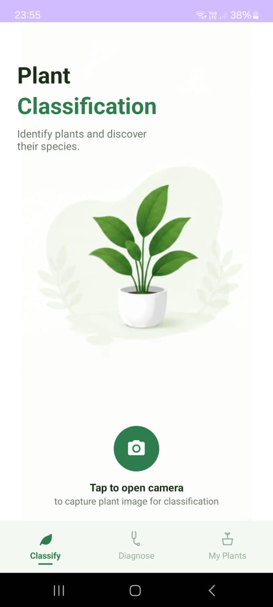
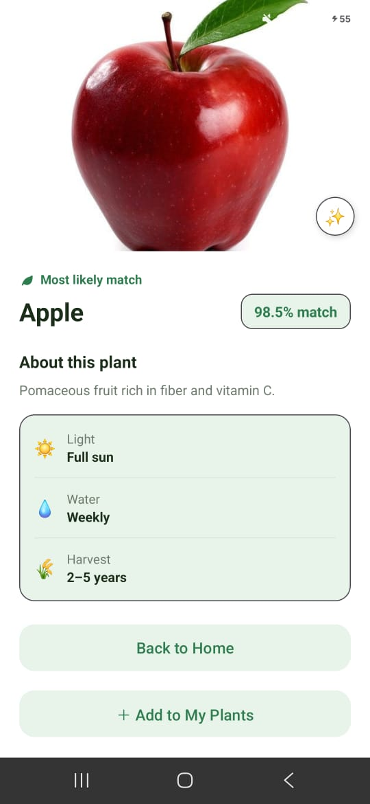
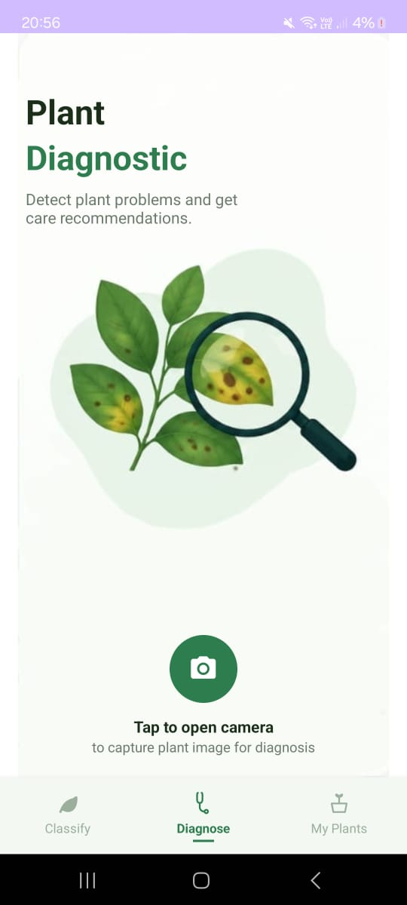
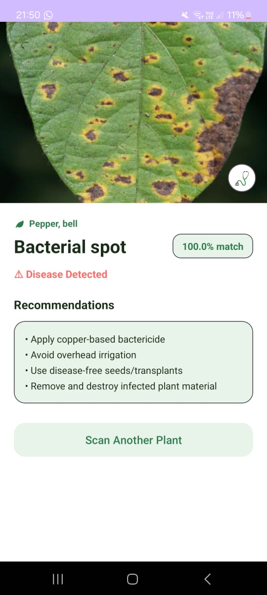
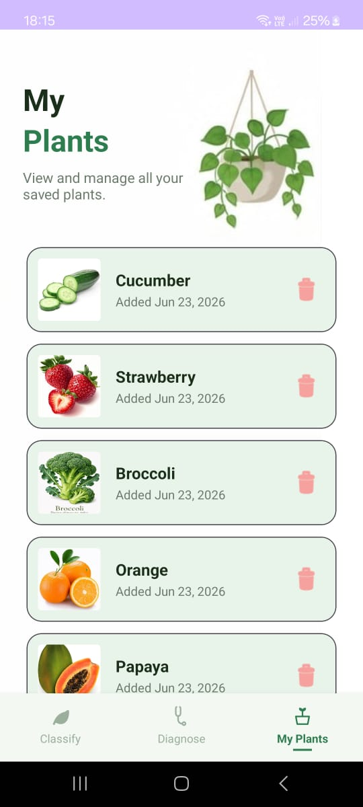

# Planta 🌱

**An Android application for plant identification and disease diagnosis using Machine Learning.**

Planta allows users to identify plants from images, detect potential plant diseases, and access basic care recommendations through an Android application powered by TensorFlow Lite.

## Features

### 🌿 Plant Classification
- Capture a plant image using the device camera.
- Identify the plant using an on-device machine learning model.
- Display the predicted plant and its model score.
- View plant information and care recommendations.

### 🔬 Plant Disease Diagnosis
- Capture an image of a plant leaf.
- Predict potential plant diseases.
- Display the predicted disease and its model score.
- Provide recommendations related to the diagnosis.

### 🪴 My Plants
- Save identified plants.
- View and manage saved plant entries.

## Screenshots

### Plant Classification





### Plant Disease Diagnosis





### My Plants



## Technologies

- **Java** — Android application development.
- **Android Studio** — Development environment.
- **TensorFlow Lite** — On-device machine learning inference.
- **SQLite** — Local data storage.

## Machine Learning Models

Planta integrates two TensorFlow Lite models:

- A plant classification model.
- A plant disease classification model.

Both models are stored locally in the application's assets, allowing predictions to run directly on the Android device.

**Note:** The scores displayed in the application are model prediction scores. They should not be interpreted as guaranteed real-world accuracy. Predictions may vary depending on image quality, lighting, background, and differences between training images and real-world photographs.

## Getting Started

### Prerequisites

- Android Studio
- Android SDK
- An Android device or emulator

### Installation

1. Clone the repository:

   ```bash
   git clone https://github.com/firdaous2005/Planta.git
   ```

2. Open the project in Android Studio.
3. Allow Gradle to sync the project.
4. Run the application on an Android device or emulator.

## Future Improvements

- Improve model generalization on real-world plant images.
- Refine the user interface and layouts.
- Expand the range of supported plant categories.
- Improve prediction reliability under different image conditions.

---

**Planta** — Bringing machine learning to everyday plant care. 🌱